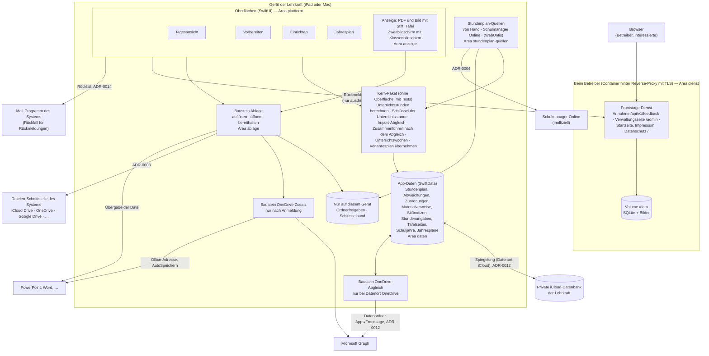

# Frontstage — Architektur

**Beschreibt, entscheidet nicht.** Jede Festlegung ist eine ADR (`docs/adr/NNNN-titel.md`); dieses
Dokument sagt, wie gebaut wird, innerhalb dessen, was die ADRs festgelegt haben, und verweist mit
„gemäß ADR-NNNN“ darauf. Begriffe folgen dem Glossar im PRD.

**Besitzt nicht:** was das Produkt kann (`docs/PRD.md`) und wie es aussieht (`DESIGN.md`).

---

## Überblick

Abgeleitet aus den Bereichen unten; bei Abweichung gilt der Bereich.

Drei Dinge, die das Bild festhält: Keine Oberfläche spricht ein Fremdsystem direkt an – dazwischen
liegt immer ein Baustein. Nutzerdaten liegen auf keinem Server des Produkts (NFR-2); nach außen gehen nur
Apple, der Ablage-Anbieter, Microsoft (nach Anmeldung) und Schulmanager (wenn gewählt) – dazu eine Rückmeldung, die
die Lehrkraft ausdrücklich an den Rückmeldedienst des Betreibers sendet (ADR-0015), ersatzweise über ihr
Mail-Programm (ADR-0014). Ordnerfreigaben und
Zugangsdaten verlassen das Gerät nie.

## Area: plattform

- area-status: detailed

Gemäß ADR-0001: eine native SwiftUI-App in einem Xcode-Projekt mit zwei Zielen, iPadOS und macOS, aus
gemeinsamem Code. Geräteunterschiede (Stift nur am Tablet, Ziehen aus dem Finder nur am Mac) liegen in
den Oberflächen, nicht im Datenmodell. Mindestversion iPadOS 26 und macOS 26 gemäß ADR-0007.

### Bauen und Verteilen

- Gemäß ADR-0008: Das Xcode-Projekt wird aus `project.yml` mit XcodeGen erzeugt und nicht eingecheckt;
  Logik ohne Oberfläche liegt im Swift-Paket `Packages/FrontstageCore` (Swift Testing, `swift test`;
  Name gemäß ADR-0009);
  Sprachmodus Swift 6 strikt.
- Gemäß ADR-0009: Bezeichner im Code englisch nach der Spalte „Im Code“ des Glossars, Kommentare
  deutsch.

- Die App wird ausschließlich auf macOS gebaut – per CI (GitHub Actions, macOS-Runner) oder auf einem
  Mac. Auf dem Entwicklungsrechner (Windows) lässt sich nur das Kern-Paket mit Swift für Windows
  testen (`scripts/swift-test.ps1`); maßgeblich bleibt der CI-Lauf.
- CI läuft nur bei Tags und auf manuellen Anstoß, nicht bei jedem Push (Runner kosten je Lauf).
- Logik, die sich ohne Oberfläche prüfen lässt (Stundenplan-Auflösung, Identität, Import-Abgleich),
  liegt in einem eigenen Swift-Paket mit Tests, damit ein CI-Lauf möglichst viel belegt.
- Verteilung an Testerinnen über TestFlight; dafür ist ein Apple-Entwicklerkonto nötig (RISK-4).
- Texte der Oberfläche liegen von Anfang an in einer Übersetzungstabelle (deutsch als erste Sprache),
  damit weitere Sprachen ohne Umbau möglich sind (Q-10).

### Kauf

- Der Einmalkauf (FR-13) ist ein dauerhafter In-App-Kauf über Apples Kaufsystem (StoreKit 2). Ob er
  besteht, prüft die App auf dem Gerät mit den signierten Kaufbelegen, die StoreKit liefert – ohne
  eigenen Server (NFR-2). Auf weiteren Geräten derselben Apple-ID meldet StoreKit den Kauf von selbst;
  „Käufe wiederherstellen“ gibt es zusätzlich, weil der App Store es verlangt.
- Freigeschaltet wird an genau einer Stelle („Freischaltung“), die Klassenbildschirm, Tafel und Erscheinungsbild abfragen.
  Ohne Kauf gilt der Standard des Erscheinungsbilds; eine gespeicherte Wahl bleibt erhalten und gilt, sobald der Kauf besteht (FR-13, FR-16).
  Ohne Kauf zeigen Klassenbildschirm und Tafel ein Kaufangebot; der Zweitbildschirm zeigt dann statt des Klassenbildschirms
  eine neutrale Fläche, und Material am Zweitbildschirm (FR-6.2) bleibt kostenlos.
- Der Kaufstand wird nicht in den App-Daten gespeichert und nicht gespiegelt – StoreKit ist die
  einzige Quelle.
- Die Schulversion (FR-13.2, später) wäre ein zweites Ziel im selben Xcode-Projekt, das die
  Freischaltung fest auf „gekauft“ setzt und als bezahlte App ohne In-App-Kauf erscheint.

### Hilfe und Rückmeldung

- Gemäß ADR-0014 liegen die Hilfeartikel (FR-17) in der App: Themen (`HelpTopic`), ihre Gruppen und verwandten
  Themen sind Daten im Kern-Paket; Titel, Kurzfassung, Stichwörter und Text jedes Artikels stehen in der
  Übersetzungstabelle (`help.<thema>.title|summary|keywords|body`, ADR-0009). Der Text ist eine kleine
  Markdown-Teilmenge (Absatz, Zwischentitel, Aufzählung, nummerierte Schritte, Hinweis; fett und Links im
  Absatz), die der Kern in Blöcke zerlegt; die Oberfläche setzt die Blöcke mit den Schriftgrößen aus DESIGN.md.
  Suche und Rangfolge rechnet der Kern (Titel vor Stichwort vor Kurzfassung vor Text, Umlaute und
  Groß-/Kleinschreibung gefaltet). Ein Test im Kern prüft, dass jedes Thema alle vier Texte hat und dass die
  Artikel nur die neutralen Beispielklassen nennen.
- Hilfeknöpfe öffnen den Artikel als Blatt an der Stelle, an der sie stehen – auch innerhalb anderer Blätter.
  Das Hilfecenter steht in Einrichten; das Menü „Hilfe“ (Mac, iPad mit Tastatur) öffnet es als Blatt über
  der Hauptansicht.
- Gemäß ADR-0015 lädt die App eine Rückmeldung zum Rückmeldedienst hoch (Area dienst), wenn die Build-Einstellung
  `FEEDBACK_URL` eine Adresse trägt (Info.plist `FrontstageFeedbackURL`, Schlüssel `FEEDBACK_APP_KEY` →
  `FrontstageFeedbackAppKey`, beide in CI aus Secrets): ein Multipart-Upload mit `URLSession`, Fortschritt, bis zu drei
  Versuchen bei Netz- und 5xx-Fehlern; vor dem ersten Senden eine einmalige Zustimmung (gemerkt in `UserDefaults`,
  nicht abgeglichen) mit Link zur Datenschutzseite. Antwortet der Dienst nicht oder fehlt die Adresse, gilt der Weg
  unten.
- Gemäß ADR-0014 geht eine Rückmeldung als E-Mail über das Mail-Programm des Systems hinaus (iPad
  `MFMailComposeViewController`, Mac `NSSharingService.composeEmail`), Rückfall Teilen-Dialog und Kopieren. Die
  Empfangsadresse kommt aus der Build-Einstellung `FEEDBACK_EMAIL` (Info.plist `FrontstageFeedbackEmail`, in CI
  aus einem Secret). Betreff, Text und Geräteangaben stellt der Kern zusammen; die Geräteangaben lesen nur
  Version, System, Modellkennung, Art des Datenorts, Erscheinungsbild und Kaufstand – nie den Gerätenamen.
- Bildschirmfotos: Beim Start einer Rückmeldung nimmt die App das Fenster der Hauptszene auf (nie die Szene des
  Zweitbildschirms), nachdem ein offenes Hilfeblatt geschlossen ist. Bilder werden beim Hinzufügen auf höchstens
  2048 Pixel Kantenlänge verkleinert. Gezeichnet wird mit PencilKit (`PKDrawing`): am iPad in `PKCanvasView` mit
  `PKToolPicker` wie auf der Tafel, am Mac – wo es `PKCanvasView` nicht gibt – mit einer eigenen Zeichenfläche,
  die Ziehbewegungen zu `PKStroke` macht. Schwärzen sind deckende Rechtecke über der Zeichnung, nicht
  Marker-Striche (Marker sind durchscheinend). Beim Senden werden Bild, Zeichnung und Schwärzung zu einem JPEG
  zusammengesetzt.
- Der Entwurf einer Rückmeldung liegt nur auf dem Gerät im Ordner „Application Support“ der App, ohne Sicherung
  und ohne Abgleich; er ist kein Datensatz des Datenorts.
- Kurz-Tipps (FR-17.5) laufen über TipKit (`Tips.configure` beim Start; im Testlauf nicht). Zurücksetzen geht nur
  vor `Tips.configure` und wirkt deshalb ab dem nächsten Start.

## Area: daten

- area-status: detailed

### Datenmodell

Gemäß ADR-0012 (SwiftData lokal; abgeglichen je nach gewähltem Datenort über die private iCloud-Datenbank
oder über den Datenordner in OneDrive; löst ADR-0010 ab, das ADR-0002 ablöste) und ADR-0005 (Identität der
Unterrichtsstunde). Wegen der iCloud-Spiegelung sind alle Eigenschaften optional oder haben einen
Vorgabewert, alle Beziehungen sind optional, und kein Modell nutzt Eindeutigkeitsregeln.

| Modell | Trägt | Hinweis |
|---|---|---|
| Stundenplan | Name, gültig ab/bis, Stundenplan-Quelle, Zahl der Wochenvarianten (1 oder 2), Bezugswoche für A, Zeitraster (je Stunde Beginn und Ende, FR-1.2) | genau einer ist aktiv |
| Stundenplan-Eintrag | Wochenvariante, Wochentag, Stunde, Klasse, Fach | gehört zu einem Stundenplan |
| unterrichtsfreier Zeitraum | von, bis, Bezeichnung | FR-7 |
| Abweichung | Datum, Schlüssel der Unterrichtsstunde, Art (Ausfall, Vertretungsstunde), bei Vertretungsstunde: Stunde, Klasse, Fach | FR-8, FR-9, FR-2.2 |
| Zuordnung | Schlüssel der Unterrichtsstunde, Position, Verweis auf das Material | FR-3, FR-3.1 |
| Materialverweis | Ordnerfreigabe, Pfad darin, ggf. OneDrive-Kennung, Anzeigename, Dateiart | gemäß ADR-0003 |
| Stiftnotiz | Verweis auf die Zuordnung, Seite (bei Bildern 1), Zeichnungsdaten, Seitengröße beim Zeichnen | **nur Ersatz** gemäß ADR-0011, wenn der Ordner des Dokuments nicht beschreibbar ist oder das Schreiben der Notiz-Datei beim Schließen scheitert; sonst liegen Stiftnotizen neben dem Dokument (Area anzeige) |
| Stundenangaben | Schlüssel der Unterrichtsstunde, Thema, Bereitlegen, Hausaufgabe | FR-11.1; höchstens ein Datensatz je Unterrichtsstunde |
| Tafelseite | Schlüssel der Unterrichtsstunde, Position, Hintergrund (leer, liniert, kariert oder ein Bild: Standbild der Kamera bzw. Vorlage, FR-12.5, FR-12.6), Zeichnungsdaten | FR-12.1, FR-12.2; die Tafelseiten einer Unterrichtsstunde bilden ihr Tafelbild; s. Area anzeige |
| Ordnerfreigabe | dauerhafter Systemverweis auf einen freigegebenen Ordner | **nur lokal je Gerät**, nicht gespiegelt (s. Area ablage) |
| Schuljahr | Kalenderjahr des Beginns (`startYear`), erster Schultag, erster Tag des zweiten Halbjahrs, letzter Schultag, Jahrgänge von Hand (Klasse → Jahrgang, nur für Klassen ohne Ziffern) | FR-15.1, gemäß ADR-0013; fachlicher Schlüssel `startYear`; keine Überschneidung zweier Schuljahre |
| Jahresplan | Fach (Schreibweise wie eingegeben), Jahrgang, `startYear` des Schuljahrs, Notiz zum Plan | FR-15, gemäß ADR-0013; fachlicher Schlüssel Fach (normalisiert) + Jahrgang + `startYear`; kein Verweis auf den Datensatz des Schuljahrs |
| Planwoche | Jahresplan (Beziehung, Löschen mit dem Plan), Montag der Kalenderwoche (leer = „nicht zugeordnet“), Position unter „nicht zugeordnet“, Thema, Notizen, Änderungszeit | FR-15.2; eine leere Planwoche (kein Thema, keine Notiz) wird nicht gespeichert bzw. gelöscht |
| Leistungsnachweis | Jahresplan (Beziehung, Löschen mit dem Plan), Montag der Kalenderwoche (leer = „nicht zugeordnet“), Tag (optional, in dieser Woche), Art (`test`, `classTest`), Titel, Änderungszeit | FR-15.2, FR-15.6 |
| Erscheinungsbild | Grundton, Akzentfarbe (sRGB-Hex, leer = Standard), Hell/Dunkel, Änderungszeit | FR-16; ein Datensatz für alle Geräte, doppelte werden zusammengeführt |

**Unterrichtsstunden werden nicht gespeichert, sondern berechnet:** aus Stundenplan, Wochenvariante des
Datums, unterrichtsfreien Zeiträumen und Abweichungen. Gespeichert wird nur, was die Lehrkraft dazu
tut (Zuordnungen, Abweichungen).

**Schlüssel der Unterrichtsstunde** gemäß ADR-0005: Datum + Klasse + Fach + laufende Nummer am Tag
(1 für die erste Stunde dieser Klasse in diesem Fach an diesem Tag, 2 für die zweite …). Klasse und
Fach werden vor dem Vergleich normalisiert (Groß-/Kleinschreibung, Leerzeichen, führende Nullen:
„8 b“, „08B“ → „8b“).

**Material ohne Stunde:** Passt zu einer Zuordnung keine berechnete Unterrichtsstunde mehr (Tag wurde
unterrichtsfrei, Klasse fällt an dem Tag weg), bleibt die Zuordnung erhalten und erscheint am
betreffenden Datum als „ohne Stunde“, bis die Lehrkraft sie verschiebt (FR-7, ADR-0005).

### Jahresplanung

Gemäß ADR-0013 (Jahresplan je Fach, Jahrgang und Schuljahr). Alle Regeln sind reine Logik im Kern-Paket
(`CoursePlan/`), mit Tests; die App speichert nur, was die Lehrkraft einträgt.

- **Unterrichtswochen werden berechnet, nicht gespeichert:** aus erstem und letztem Schultag des Schuljahrs
  und den unterrichtsfreien Zeiträumen (FR-7). Unterrichtstag = Montag bis Freitag im Schuljahr, nicht
  unterrichtsfrei; Unterrichtswoche = ISO-Kalenderwoche mit mindestens einem Unterrichtstag (Woche beginnt
  am Montag, Woche 1 des Kalenderjahrs enthält dessen ersten Donnerstag). Nummeriert ab 1 in zeitlicher
  Reihenfolge; Halbjahr = Halbjahr des ersten Unterrichtstags der Woche (vor dem Beginn des zweiten
  Halbjahrs → erstes). Der Stundenplan zählt nicht mit: Eine Woche ohne Stunde dieses Fachs ist trotzdem
  eine Unterrichtswoche.
- **Jahrgang einer Klasse:** erste Ziffernfolge in `SchoolClass.normalized` („8b“ → 8, „q11“ → 11, gültig
  1–13); sonst der von Hand gesetzte Jahrgang aus dem Schuljahr; sonst keiner (die Klasse hängt an keinem
  Jahresplan).
- **Zuordnung Planwoche ↔ Woche** über den Montag. Einträge, deren Montag leer ist oder keine Unterrichtswoche
  des Schuljahrs mehr trifft, zeigt der Jahresplan unter „nicht zugeordnet“ (leerer Montag nach Position,
  dann verwaiste nach Datum). Zuweisen setzt den Montag; ein Leistungsnachweis mit Tag behält dabei seinen
  Wochentag, wenn der in der Zielwoche ein Unterrichtstag ist, sonst verliert er den Tag.
- **Vorjahresplan übernehmen** (FR-15.4): Woche n des Quellplans → Woche n des Zielschuljahrs. Ziel hat
  bereits Thema oder Notiz in dieser Woche → die Planwoche der Quelle wird „nicht zugeordnet“ (nichts wird
  überschrieben). Quellwoche ohne Zielwoche (n größer als die Zahl der Zielwochen) und „nicht zugeordnete“
  Quelleinträge → „nicht zugeordnet“, in Wochenreihenfolge. Leistungsnachweise: gleicher Wochentag in der
  Zielwoche, wenn Unterrichtstag, sonst ohne Tag; ein gleicher Leistungsnachweis (Woche, Tag, Art, Titel)
  wird nicht doppelt angelegt. Die Notiz zum Plan wird angehängt, wenn sie im Ziel fehlt. Es entstehen neue
  Datensätze mit neuen Kennungen; der Quellplan bleibt unverändert.
- **Frühere Jahre** (FR-15.3): Jahrespläne mit gleichem Fach (normalisiert) und Jahrgang und kleinerem
  `startYear`, neuestes zuerst. Der Vergleich stellt sie Zeile für Zeile nach Wochennummer ab Beginn des
  Schuljahrs nebeneinander (dieselbe Zählung wie beim Übernehmen); kürzere Jahre haben leere Zellen; die
  Halbjahresgrenze steht je Spalte. Nur lesen.
- **Hinweis zur Unterrichtsstunde** (FR-15.5, FR-15.6): Für den Schlüssel einer Unterrichtsstunde (Datum,
  Klasse, Fach) wird berechnet: Schuljahr, das das Datum enthält → Jahrgang der Klasse → Jahresplan mit
  diesem Fach und Jahrgang → Planwoche und Leistungsnachweise der Kalenderwoche des Datums. Ergebnis:
  geplantes Thema (oder keines) und Leistungsnachweise – mit Tag nur an diesem Tag, ohne Tag als „diese
  Woche“. Ausfälle bekommen keinen Hinweis. Tagesansicht und Vorbereiten zeigen den Hinweis an der
  Unterrichtsstunde; Vorbereiten bietet das Thema als Thema der Stunde an (`LessonInfo.topic`, FR-11.1) und
  schreibt es nur auf Tipp. Gespeichert wird nichts davon.
- **Abgleich:** vier neue Modelle in beiden Datenorten (gemäß ADR-0012): `SyncModel` und `RecordPayload` im
  Kern, `RecordCodec` in der App, Reihenfolge Schuljahr → Jahresplan → Planwoche → Leistungsnachweis
  (Eltern vor Kindern). Dateien im Datenordner: `SchoolYear/`, `CoursePlan/`, `PlanWeek/`, `Assessment/`.
  Ein Gerät mit älterer App-Version kennt die Ordner nicht und lässt sie unberührt (RISK-10).
  Dazu kommt der Ordner `Theme/` (Erscheinungsbild, ein Datensatz): ein Gerät mit älterer Version lässt ihn unberührt.

### Datenort

Gemäß ADR-0012 wählt die Lehrkraft beim Einrichten den Datenort (FR-14); er gilt je Gerät und wird
nicht selbst abgeglichen (`UserDefaults`), auf allen Geräten einer Lehrkraft muss derselbe gewählt sein.
Ein zweites Gerät übernimmt ihn per Koppeln (FR-14.1, unten).

| Datenort | Arbeitsspeicher | Abgleich |
|---|---|---|
| iCloud | SwiftData lokal (eigene Speicherdatei) | Spiegelung in die private iCloud-Datenbank durch das System |
| OneDrive | SwiftData lokal, ohne Spiegelung (eigene Speicherdatei) | eigener Baustein „OneDrive-Abgleich“ über Microsoft Graph |

OneDrive-Abgleich:

- Der Datenordner ist der Ordner der App in OneDrive (`/me/drive/special/approot`, für die Lehrkraft
  sichtbar als `Apps/Frontstage`). Darin `library.json` (zufällige Bibliothekskennung, Formatversion) und
  je Modell ein Unterordner mit `<Kennung>.json` je Datensatz – Kennung, Änderungszeitpunkt, Gerät,
  Löschmarke, Inhalt. Zeichnungen und Bilder als `<Kennung>.<Feld>.<Prüfsumme>.bin` daneben
  (inhaltsadressiert: nie überschrieben, also nie im Konflikt; verwaiste erst nach 7 Tagen entfernt).
- Der Baustein spricht nur Graph (`graph.microsoft.com`) über die Anmeldung aus dem Bereich ablage
  (MSAL); Berechtigung `Files.ReadWrite`, erst bei der Wahl von OneDrive angefordert. Er schreibt nur in
  den App-Ordner, nie in Material.
- Ein Durchgang: Änderungen per Delta-Abfrage auf den App-Ordner holen (bei `410 Gone` neu aufzählen;
  ohne Delta bei Schulkonten: Modellordner auflisten, Q-33), geänderte Dateien laden, je Datensatz gilt
  der zuletzt geschriebene Stand (eine noch nicht geschriebene lokale Änderung mit ihrem
  Änderungszeitpunkt), dann dasselbe Zusammenführen wie nach einem iCloud-Abgleich (Nebenläufigkeit
  unten), dann lokale Änderungen schreiben (`PUT …:/content` mit `If-Match` auf das bekannte eTag).
- Auslöser: Start, Wechsel in den Vordergrund, Rückkehr des Netzes, 1 s nach jedem lokalen Speichern
  (nur Schreiben) und alle 60 s im Vordergrund.
- Was geändert ist, merkt sich ein lokales Buch je Gerät (Prüfsumme und Stand je Datensatz, eTag je
  Datei, Delta-Link) – nicht abgeglichen, nicht gesichert. Die Records bekommen dafür keine neuen Felder.
- Löschen schreibt eine Löschmarke (`deleted: true`); Löschmarken älter als 90 Tage entfernt die App.
  Lokal gelöscht wird nur durch eine gelesene Löschmarke, nie weil eine Datei fehlt.
- Konfliktkopien (etwa von einem OneDrive-Synchronisierungsprogramm am PC: `<Kennung>-<Rechner>.json`)
  werden wie ein zweiter Stand desselben Datensatzes behandelt und danach entfernt.
- Wechsel des Datenorts: in der laufenden App; alle Datensätze werden mit Kennung und Anlagezeit in die
  Speicherdatei des neuen Orts übertragen, der Container wird neu gebaut. Liegen im Datenordner schon
  Daten (zweites Gerät), gilt für gemeinsame Datensätze der Stand im Datenordner; nur lokal Vorhandenes
  wird geschrieben. Der alte Ort bleibt unberührt stehen.
- Die App schreibt nur in den Datenordner, nie in Material (FR-3.4); Stiftnotizen neben dem Dokument
  (ADR-0011) laufen über den Zugriff auf das Material, nicht über den Datenort.

Koppeln (FR-14.1), ohne Server:

- Das erste Gerät zeigt in Einrichten einen QR-Code mit Formatversion, Datenort und bei OneDrive
  Bibliothekskennung, Laufwerks- und Ordnerkennung des App-Ordners sowie einem gekürzten Kontonamen als
  Hinweis. Erzeugt mit Core Image (`CIFilter.qrCodeGenerator()`).
- Das zweite Gerät scannt: am iPad mit VisionKit (`DataScannerViewController`), am Mac mit der Kamera
  über AVFoundation und Vision (`DetectBarcodesRequest`). Ohne Kamera zeigt das zweite Gerät den Hinweis,
  am anderen Gerät zu scannen, oder die Lehrkraft wählt von Hand.
- iCloud: der Code setzt nur den Datenort. OneDrive: Anmeldung mit demselben Microsoft-Konto, dann
  öffnet die App den App-Ordner direkt über Graph (keine Ordnerauswahl) und prüft Laufwerk, Ordner und
  `library.json`; passt etwas nicht (anderes Konto, andere Bibliothek), ändert sie nichts und sagt das.
- Der Code überträgt keinen Zugriff – nur Kennungen, die ohne Anmeldung am selben Konto nichts öffnen.

### Nebenläufigkeit

Gemäß ADR-0012 (für beide Datenorte) gewinnt bei gleichzeitiger Änderung desselben Datensatzes der zuletzt abgeglichene
Stand. Je Datenart:

| Datenart | Verhalten | Unterlegener Wert |
|---|---|---|
| Zuordnung hinzufügen (zwei Geräte, dieselbe Unterrichtsstunde) | beide bleiben; doppelte Verweise auf dieselbe Datei in derselben Unterrichtsstunde führt die App nach dem Abgleich zu einem zusammen | geht nicht verloren |
| Reihenfolge der Materialien | zuletzt abgeglichene Reihenfolge gilt; gleiche Positionen werden nach Anlagezeit aufgelöst | Reihenfolge des anderen Geräts verloren – hinnehmbar, sichtbar und sofort korrigierbar |
| Stundenplan-Eintrag ändern | zuletzt abgeglichener Stand gilt | verloren – selten (Stundenplan ändert sich wenige Male im Jahr) |
| Abweichung (Ausfall, Vertretungsstunde) | doppelte gleichartige Abweichungen werden zusammengeführt | geht nicht verloren |
| Stiftnotiz (zwei Geräte, dieselbe Seite derselben Zuordnung) | zuletzt abgeglichener Stand der Seite gilt | Striche des anderen Geräts auf dieser Seite verloren – selten (geschrieben wird am Tablet im Unterricht, s. Area anzeige) |

| Tafelseite (zwei Geräte, dieselbe Seite) | zuletzt abgeglichener Stand der Seite gilt | wie Stiftnotiz – selten |
| Stundenangaben (Thema, Hinweis) | doppelte Datensätze derselben Unterrichtsstunde werden zusammengeführt; je Feld gilt der zuletzt abgeglichene Stand | überschriebener Text verloren – hinnehmbar, sichtbar und sofort korrigierbar |
| Schuljahr (zwei Geräte legen dasselbe an) | doppelte mit gleichem `startYear` werden zusammengeführt, der älteste bleibt | Daten des jüngeren verloren – sichtbar, sofort korrigierbar |
| Jahresplan (zwei Geräte legen denselben an) | doppelte mit gleichem Schlüssel werden zusammengeführt; Planwochen und Leistungsnachweise des aufgegebenen hängt die App vorher an den behaltenen | geht nicht verloren |
| Planwoche (zwei Geräte, dieselbe Woche) | doppelte Planwochen eines Plans mit gleichem Montag werden zusammengeführt; der Inhalt der zuletzt geänderten gilt | Thema oder Notiz des anderen Geräts verloren – hinnehmbar, sichtbar |
| Leistungsnachweis | gleiche (Plan, Montag, Tag, Art, Titel) werden zusammengeführt | geht nicht verloren |
| Erscheinungsbild (zwei Geräte) | doppelte werden zusammengeführt; der Inhalt des zuletzt geänderten gilt | Wahl des anderen Geräts verloren – sichtbar, sofort korrigierbar |

Zusammenführen heißt: Nach jedem Abgleich sucht die App Datensätze mit gleichem fachlichem Schlüssel
und behält den ältesten. Werden dabei zwei Zuordnungen zu einer, werden die Stiftnotizen der
aufgegebenen vorher an die behaltene gehängt.

### Betrieb

Sicherung und Wiederherstellung übernimmt der Datenort (gemäß ADR-0012): iCloud im Konto der Lehrkraft
oder der Datenordner in ihrem OneDrive. Der zu
prüfende Wiederherstellungsweg ist: App auf einem zweiten Gerät mit demselben Apple-Konto
installieren – Stundenplan und Zuordnungen erscheinen ohne Zutun; nur die Ordnerfreigaben müssen dort
einmal neu erteilt werden. Bei Datenort OneDrive: das zweite Gerät koppeln oder OneDrive von Hand wählen und mit
demselben Microsoft-Konto anmelden (FR-14.1). Stiftnotizen liegen neben dem Dokument in der Ablage (ADR-0011) und
kommen mit dieser, nicht mit dem Datenort.

## Area: ablage

- area-status: detailed

Gemäß ADR-0003.

### Zugriff auf Material

- Die Lehrkraft gibt einmal je Gerät einen oder mehrere Ordner ihrer Ablage frei (Ordnerauswahl des
  Systems). Die App hält dafür je Ordner eine Ordnerfreigabe; diese ist an das Gerät gebunden und wird
  nicht gespiegelt.
- Ein Materialverweis nennt die Ordnerfreigabe über einen gespiegelten Namen der Freigabe plus den
  Pfad darin. Auf einem zweiten Gerät wird derselbe Ordner einmal freigegeben und dem Namen zugeordnet;
  danach lösen alle Verweise auch dort auf.
- Löst ein Verweis nicht auf (Datei umbenannt, verschoben, Freigabe fehlt), zeigt die Zuordnung das an
  und bietet Neuverknüpfen an; sie verschwindet nicht.

### Öffnen

| Material | Weg |
|---|---|
| Präsentation, Dokument, Tabelle – ohne OneDrive-Anmeldung | Übergabe der Datei an die zuständige App (Öffnen am Ort, keine Kopie) |
| Office-Datei in OneDrive, Lehrkraft bei Microsoft angemeldet | Öffnen als Cloud-Dokument über die Office-Adresse, damit AutoSpeichern greift (FR-5.1) |
| PDF, Bild | eigene Anzeige (Area anzeige) |

Schlägt das Öffnen als Cloud-Dokument fehl oder dauert es zu lang, fällt die App auf die Übergabe der
Datei zurück – das Verhalten, das OneDrive Opener am Mac dafür gefunden hat (Fenster „öffnet
ungewöhnlich lange“ mit „Lokal öffnen“).

### Bereithalten

Für NFR-1 stößt die App für das Material der kommenden Unterrichtsstunden (heute und nächster
Unterrichtstag) das Herunterladen über die Dateien-Schnittstelle an, sobald Netz da ist – beim Öffnen
der App und beim Zuordnen. Die Tagesansicht zeigt je Material, ob es auf dem Gerät liegt.

### Fremdsysteme

- **Dateien-App und Ablage-Anbieter.** Grenze: ein Baustein „Ablage“, der Verweise auflöst, Dateien
  öffnet und bereithält; keine Oberfläche spricht Anbieter direkt an. Güte der Beschreibung:
  dokumentierte Systemschnittstelle, das Verhalten der einzelnen Anbieter dahinter ist aber
  unterschiedlich und nur durch Ausprobieren belegt. Bei Abweichung: Material als „nicht verfügbar“
  kennzeichnen, nie stillschweigend einen alten Stand zeigen.
- **Microsoft Graph und Office-Adressen (OneDrive).** Grenze: ein Baustein „OneDrive-Zusatz“, nur aktiv
  nach Anmeldung. Güte: Graph ist dokumentiert; das Format der Office-Adresse, mit der PowerPoint ein
  Cloud-Dokument öffnet, ist rückentwickelt (Erkenntnis aus OneDrive Opener, dort für den Mac belegt,
  für iPadOS ungeprüft – Q-18). Bei Abweichung: Rückfall auf die Übergabe der Datei.

## Area: stundenplan-quellen

- area-status: detailed

Gemäß ADR-0004. Jede Stundenplan-Quelle ist ein Baustein mit derselben Schnittstelle: Er liefert eine
Liste von Stundenplan-Einträgen und – wenn die Quelle das kann – Abweichungen für einen Zeitraum.
Bausteine: „von Hand“ (liefert nichts, der Stundenplan wird in der App gepflegt), „Schulmanager
Online“, später „WebUntis“ (FR-2.1).

### Import-Abgleich

- Ein Import ersetzt den Stundenplan nicht blind: Er wird mit dem vorhandenen verglichen. Neue und
  geänderte Einträge werden der Lehrkraft vor der Übernahme gezeigt; von Hand geänderte Einträge gehen
  nie stillschweigend verloren (AK-3).
- Die Vorschau liegt nur auf dem Gerät, das abgefragt hat. Verwirft die Lehrkraft sie (oder behält bei einem
  Konflikt ihre Fassung), merkt sich das Gerät den Stundenplan-Teil des Stands als Prüfsumme; dieselbe
  Vorschau erscheint nicht wieder, erst ein neuer Unterschied. Ist der gespiegelte Stand neuer als die
  Vorschau (das andere Gerät hat später abgefragt), wird sie verworfen statt übernommen.
- Abweichungen aus der Quelle (Vertretungen, Ausfall) werden als Abweichungen mit Herkunft „Quelle“
  gespeichert und beim nächsten Import ersetzt; von Hand angelegte Abweichungen bleiben unberührt.
- Zeitpunkt gemäß ADR-0004: beim ersten Öffnen der App am Tag, soweit möglich als
  Hintergrund-Aktualisierung am Morgen, und auf Knopfdruck. Die Tagesansicht zeigt, von wann der Stand
  ist.

### Fremdsysteme

- **Schulmanager Online.** Grenze: allein der Baustein „Schulmanager Online“; fällt er aus, bleiben
  Stundenplan, Zuordnungen und Tagesansicht nutzbar. Güte der Beschreibung: rückentwickelt, ohne
  Zusage des Anbieters; für Lehrerkonten ungeprüft (Q-16). Bei Abweichung (Anmeldung scheitert,
  Antwort hat unerwartete Form): kein Teilimport, letzter Stand bleibt, die Tagesansicht zeigt das
  Alter des Stands und einen Hinweis; dreimal in Folge gescheitert → Hinweis, den Stundenplan von Hand
  zu pflegen.
- Zugangsdaten liegen nur im Schlüsselbund des Geräts (NFR-4) und werden nicht gespiegelt; auf einem
  zweiten Gerät meldet sich die Lehrkraft dort erneut an. Ein Gerät ohne Zugangsdaten fragt nicht ab und
  zählt keine Fehler; es zeigt den gespiegelten Stand mit dem ruhigen Hinweis, dass die Anmeldung auf
  diesem Gerät nötig ist. Nach falschen Zugangsdaten oder einem Konto mit mehreren Schulen werden die
  Zugangsdaten gelöscht (damit enden auch die automatischen Abfragen); nach Netz-, Server- oder
  Formfehlern bleiben sie.

## Area: dienst

- area-status: detailed

Gemäß ADR-0015: ein Container „Frontstage-Dienst“ beim Betreiber, der Rückmeldungen annimmt (FR-18), die
Verwaltungsseite trägt (FR-18.1) und Startseite, Impressum und Datenschutz ausliefert (FR-19, FR-19.1). Er hält keine
Nutzerdaten der App (NFR-2) – nur, was eine Lehrkraft ausdrücklich als Rückmeldung sendet. Die App funktioniert ohne
ihn vollständig.

### Aufbau

- Ordner `server/`: Paket `frontstage_service` (FastAPI-Anwendung), `templates/` (Jinja2 für die Verwaltungsseite),
  `landing/` (statische Startseite samt Impressum und Datenschutz), `tests/` (pytest, HTTPX), `Dockerfile`,
  `docker-compose.yml`, `pyproject.toml` (Abhängigkeiten mit uv gesperrt), `README.md` (Betrieb).
- Ein Prozess (Uvicorn), ein Image (Python 3.12 slim, Nutzer ohne Root-Rechte), ein Volume `/data` mit
  `frontstage.sqlite3` (WAL) und `attachments/<rückmeldung>/<n>.<png|jpg>`.
- Einstellungen nur aus Umgebungsvariablen: `APP_KEY`, `ADMIN_PASSWORD_HASH` (Argon2), `SESSION_SECRET`,
  `RETENTION_DAYS` (365), `DATA_DIR` (`/data`), `PUBLIC_BASE_URL`. Fehlt eine Pflichtangabe, startet der Dienst nicht.

### Annahme

- `POST /api/v1/feedback`, Multipart: Teil `feedback` (JSON: `kind` `idea|issue`, `text` 1–10 000 Zeichen, `topic`
  optional aus der Liste der Hilfethemen, `deviceInfo` optional, `appVersion`), Teile `attachment` 0–5 (PNG oder JPEG,
  am Inhalt erkannt, je ≤ 8 MB, zusammen ≤ 25 MB). Header `X-Frontstage-App-Key` muss `APP_KEY` gleichen (Vergleich in
  konstanter Zeit). Antwort 201 mit `id` (UUID) und `reference` (acht Zeichen, für Löschanfragen).
- Fehler: 401 ohne/mit falschem Schlüssel, 411 ohne `Content-Length` (sonst wäre die Größengrenze per chunked
  Übertragung umgehbar; die App sendet die Länge immer), 413 bei zu großen oder zu vielen Teilen, 415 bei anderen Bildformaten, 422
  bei ungültigem JSON, 429 bei Überschreitung der Begrenzung (10 je Minute, 30 je Stunde je Absenderadresse, gelesen aus
  `X-Forwarded-For` des vertrauten Proxys). Bilder werden vor dem Speichern dekodiert und ohne Metadaten neu
  geschrieben (EXIF entfernt).
- Die Begrenzung lebt im Speicher des Prozesses (ADR-0015, Kosten).

### Verwaltung

- `/admin`: serverseitig gerendert (Jinja2), Teilaktualisierungen mit htmx, keine Fremd-Skripte. Anmeldung mit
  Passwort gegen `ADMIN_PASSWORD_HASH`; Sitzung als signiertes Cookie (`Secure`, `HttpOnly`, `SameSite=Strict`,
  acht Stunden); jede ändernde Anfrage trägt ein CSRF-Token; fünf Fehlversuche je Adresse sperren zehn Minuten.
- Liste mit Filtern (Art, Bearbeitungsstand, Zeitraum), Seiten zu 50; Detail mit Text, Hilfethema, Geräteangaben,
  Bildern; Bearbeitungsstand (`FeedbackStatus`), interne Notiz, Löschen mit Rückfrage; Ausfuhr der gefilterten Liste
  als CSV (UTF-8 mit BOM, Semikolon) oder JSON; Bilder nur nach Anmeldung (`/admin/attachments/...`).
- Sicherheitsheader für alle Seiten: `Content-Security-Policy` ohne Inline-Skripte, `X-Content-Type-Options`,
  `Referrer-Policy: no-referrer`, `frame-ancestors 'none'`.

### Startseite

- Statische Dateien unter `/` (HTML, CSS, wenig JavaScript), Schriften mit freier Lizenz (OFL) als WOFF2 auf dem
  eigenen Server statt über Google Fonts (keine Übertragung von Besucher-Adressen an Dritte), keine Cookies, keine
  Messung, keine Fremd-Skripte. Darstellungen der App sind nachgebaute Illustrationen nach DESIGN.md (Grundton warm, Akzent Petrol) bzw. aus
  `mockup/`, keine Bildschirmfotos echter Daten. Impressum und Datenschutz sind eigene Seiten (`/impressum`,
  `/datenschutz`); die App verlinkt `/datenschutz`.

### Aufbewahrung und Betrieb

- Beim Start und danach alle 24 Stunden löscht der Dienst Rückmeldungen, die älter als `RETENTION_DAYS` sind, samt
  Bildordner (FR-18.2).
- `GET /healthz` prüft, ob die Datenbank lesbar ist. Der Reverse-Proxy des Betreibers beendet TLS und setzt
  `X-Forwarded-For`; der Container lauscht nur intern.
- Sicherung: das Volume täglich kopieren (SQLite mit `.backup` bzw. `VACUUM INTO`); Image regelmäßig neu bauen
  (RISK-12).
- CI: eigener Linux-Lauf (`.github/workflows/server.yml`) mit Tests und Image-Bau, bei Pull Requests mit Änderungen
  unter `server/**` und von Hand; berührt die macOS-Läufe nicht.

## Area: anzeige

- area-status: detailed

Eigene Anzeige von PDFs und Bildern mit Stift (FR-6), gebaut mit den Systembausteinen für
PDF-Darstellung (PDFKit) und Stifteingabe (PencilKit), gemäß ADR-0001. Präsentiert wird über die
Bildschirmverbindung des Systems (AirPlay oder Kabel); die App baut keine eigene Übertragung, liefert
dem verbundenen Bildschirm aber einen eigenen Inhalt (FR-6.2).

### Zweitbildschirm

Grundlage ist Apples Entwicklerdoku „Presenting content on a connected display“ (gelesen 2026-11-13):

- Ohne Zutun der App spiegelt das System das Tablet-Bild auf den verbundenen Bildschirm. Für eigenen
  Inhalt stellt das System eine zweite Szene mit der Rolle `windowExternalDisplayNonInteractive`
  bereit; ihr Inhalt füllt den ganzen Bildschirm und nimmt keine Eingaben an. (Eine „Szene“ ist in
  UIKit eine eigenständige Instanz der Oberfläche mit eigenem Fenster. SwiftUI hat dafür keinen
  eigenen Baustein – die Szene wird in UIKit angelegt und zeigt eine SwiftUI-Ansicht über
  `UIHostingController`.)
- Ab iOS 27 bekommt die App diese Szene nur, wenn sie vorher ein Szenen-Zubehör anmeldet
  (`UISceneAccessory.externalNonInteractive`, angemeldet an einem View-Controller mit
  `registerSceneAccessory`). In früheren Versionen verband das System die Szene von selbst. Die
  Anmeldung gilt, solange dieser View-Controller gezeigt wird.
- Weil die Tagesansicht nie auf dem Zweitbildschirm erscheinen darf (FR-6.2), wird das Zubehör an der
  Hauptansicht der App angemeldet und gilt damit, solange die App im Vordergrund ist – nicht erst, wenn
  die Anzeige offen ist. Sonst würde das System die Tagesansicht spiegeln.
- Aus demselben Grund nimmt die App eine Szene mit dieser Rolle in jeder Version selbst an, auch ab
  iOS 27: Fehlt in einem Stand der Weg über das Zubehör (gebaut mit einem Werkzeug ohne die
  iOS-27-Schnittstellen), bekommt die Szene trotzdem den Inhalt des Zweitbildschirms und nie die
  Hauptansicht.
- Die Szene zeigt genau einen von vier Zuständen (FR-11.5): **Klassenbildschirm** (Ruhezustand,
  FR-11), **Material** (aktuelle Seite mit Stiftnotizen), **Tafel** (aktuelle Tafelseite, FR-12) oder
  **Dunkel** (FR-11.4) – immer ohne Bedienelemente. Blättern, Zoomen und Schreiben am Tablet werden
  dorthin übertragen.
- Der Zustand liegt an einer Stelle („Zustand des Zweitbildschirms“), die beide Szenen beobachten:
  Die Szene auf dem Tablet ändert ihn, die Szene auf dem Zweitbildschirm zeichnet ihn. Das
  Vorschaubild am Tablet (FR-11.5) ist dieselbe Ansicht noch einmal, verkleinert – kein Bildschirmfoto,
  damit es nie etwas anderes zeigt als der Zweitbildschirm.
- Dieser Zustand samt Timer (FR-11.2) und Arbeitsform (FR-11.3) ist flüchtig: Er gilt für die laufende
  Unterrichtsstunde auf diesem Gerät, wird nicht gespeichert und nicht gespiegelt. Der Timer rechnet
  aus einem Endzeitpunkt, nicht aus gezählten Sekunden, damit er nach einem kurzen Wechsel in eine
  andere App stimmt.
- Die App bleibt ohne verbundenen Bildschirm voll nutzbar; Verbinden und Trennen mitten in der Stunde
  ändern nur, ob die zweite Szene existiert.
- Die Verbindung startet die App nicht selbst (FR-11.6): Dafür gibt es keine erlaubte Schnittstelle;
  die einbaubare AirPlay-Auswahl (`AVRoutePickerView`) leitet nur Ton und Video weiter und liefert
  keine zweite Szene. Den Verbindungsstand leitet die App daraus ab, ob das System die zweite Szene
  verbunden hat – AirPlay und Kabel sind für sie dasselbe. „So verbinden“ ist eine Anleitung in der
  App, kein Sprung in das Kontrollzentrum (auch dafür gibt es keine Schnittstelle).
- Geht die App in den Hintergrund (Material öffnet in PowerPoint, FR-5), endet ihr Einfluss auf den
  Bildschirm; es gilt, was die andere App und das System tun (RISK-5, Q-22).
- Am Mac regelt das System, ob ein AirPlay-Bildschirm spiegelt oder eigener Bildschirm ist; die App
  baut dafür nichts Eigenes.

Nicht belegt und am Gerät zu prüfen: das Verhalten über AirPlay im Schulnetz (Verzögerung beim
Schreiben), und der Übergang zwischen eigener Szene und Spiegelung beim App-Wechsel.

### Darstellung

- Die Datei wird über den Baustein „Ablage“ gelesen (Ordnerfreigabe, Area ablage) und nie verändert;
  die Anzeige schreibt nur die Stiftnotizen daneben (Notiz-Datei und Notiz-PDF, Abschnitt Stiftnotizen, gemäß
  ADR-0011).
- Ein PDF wird seitenweise gezeigt; ein Bild gilt als Dokument mit einer Seite. Über jeder Seite liegt
  eine durchsichtige Zeichenfläche, die mit der Seite zoomt und verschiebt.
- Geschrieben wird am Tablet mit dem Stift. Am Mac werden Stiftnotizen angezeigt, aber nicht
  gezeichnet (Area plattform: Stift nur am Tablet). Hinweis für den Bau: Die Zeichenfläche von
  PencilKit gibt es nach heutigem Stand nur auf dem Tablet, das Datenformat der Zeichnung lässt sich
  aber auch am Mac lesen und darstellen – beim ersten Bau zu belegen.

### Klassenbildschirm

- Klasse, Fach und Stundenende kommen aus der berechneten laufenden Unterrichtsstunde (Area daten),
  Thema und Hinweis aus den Stundenangaben (FR-11.1). Er bekommt nur die Daten dieser einen
  Unterrichtsstunde gereicht – so kann er nichts anderer Klassen und keine Dateinamen zeigen (FR-11).
- Welche Fassung er zeigt (vor Beginn, während, letzte fünf Minuten, kein Unterricht mehr), wird aus
  Uhrzeit und den berechneten Unterrichtsstunden des Tages abgeleitet, nicht gespeichert (FR-11.7).
  Ausfälle zählen nicht mit. Vor Beginn bekommt er die Daten der nächsten Unterrichtsstunde gereicht.
- Der Timer liegt als eigene Schicht über allen Zuständen außer Dunkel, damit er auch über Material
  und Tafel sichtbar bleibt; am Ende gibt er ein sichtbares und hörbares Signal (FR-11.2). Der Ton
  läuft über die Tonausgabe des Systems und damit bei AirPlay über den Bildschirm im Klassenraum.

### Tafel

- Die Tafel ist dieselbe Zeichenfläche wie in der Darstellung von Material, nur ohne Datei darunter:
  statt einer PDF-Seite liegt ein gezeichneter Hintergrund (leer, liniert, kariert) unter der
  Stiftschicht.
- Je Seite ein Datensatz „Tafelseite“ an der Unterrichtsstunde (Area daten), gespeichert und
  über den Datenort abgeglichen (ausgelagerte Zeichnungsdaten, Speichern beim Absetzen des Stifts; gemäß
  ADR-0012). Die App schreibt dafür nicht in die Ablage – anders als bei Stiftnotizen (ADR-0011), denn ein Tafelbild
  gehört zu keinem Dokument.
- „Letztes Tafelbild“ (FR-12.3) wird berechnet, nicht gespeichert: die jüngste frühere
  Unterrichtsstunde mit gleicher Klasse und gleichem Fach, zu der Tafelseiten existieren. Fällt eine
  Unterrichtsstunde später aus dem Stundenplan, bleiben ihre Tafelseiten erhalten und darüber
  erreichbar.
- Sichern als PDF (FR-12.4): Die App erzeugt das PDF aus Hintergrund und Zeichnung und übergibt es
  dem Teilen-Dialog des Systems; die Lehrkraft wählt dort das Ziel. Die App schreibt also auch hier
  nicht selbst über eine Ordnerfreigabe in die Ablage, und es entsteht kein zweiter Stand eines
  Materials (FR-3.4 betrifft Material, nicht Tafelbilder).
- Geschrieben wird am Tablet. Am Mac lassen sich Tafelbilder ansehen und als PDF sichern, nicht
  zeichnen (wie bei Stiftnotizen).
- **Kamera (FR-12.5):** Das Livebild der Kamera läuft als Hintergrund unter der Stiftschicht und
  wird nicht gespeichert. „Standbild“ legt eine neue Tafelseite an, deren Hintergrund das Bild ist
  (ausgelagerter Anhang wie die Zeichnungsdaten). Die App braucht dafür die Kamerafreigabe des
  Systems; ohne sie fehlt nur diese Funktion. Standbilder können Arbeiten von Schülerinnen und
  Schülern zeigen – sie liegen wie alle App-Daten nur im Datenort der Lehrkraft, also in ihrem iCloud oder
  ihrem OneDrive (NFR-2, ADR-0012).
- **Vorlage (FR-12.6):** Die gewählte Seite oder ihr Ausschnitt wird einmal als Bild gerendert und
  als Hintergrund der neuen Tafelseite gespeichert. Die Tafelseite hält damit ein Abbild, keinen
  Verweis: Ändert sich die Datei später, bleibt die Tafelseite, wie sie war. Das ist keine Kopie der
  Datei im Sinn von FR-3.4 – in der Ablage entsteht nichts, und das Material bleibt der eine Stand.
- **Abdecken (FR-12.7):** Die Abdeckung gehört zum flüchtigen Zustand des Zweitbildschirms, nicht zum
  Tafelbild. Die Szene auf dem Zweitbildschirm zeichnet sie deckend, die am Tablet durchscheinend.

### Stiftnotizen

Gemäß ADR-0011 (löst ADR-0006 ab) liegen Stiftnotizen neben dem Dokument in der Ablage; gemäß FR-6.1
gehören sie zur Unterrichtsstunde. Das Original wird nie verändert.

- **Notiz-Datei:** neben `<Name>.<Endung>` der Ordner `<Name>.frontstage-notizen/`, darin je
  Unterrichtsstunde eine Datei mit dem Schlüssel in dateinamentauglicher Form, z. B.
  `2026-11-17_8b_englisch_1.json` (umkehrbar; `|` aus dem Speichertext des Schlüssels ist in OneDrive und
  Windows verboten; maßgeblich ist das Feld `lessonKey` in der Datei, gemäß ADR-0005) mit
  Zeichnungsdaten je Seite (PencilKit-Daten, Base64) und der Seitengröße beim Zeichnen. Je Stunde eine
  Datei, damit zwei Geräte nur bei derselben Stunde dieselbe Datei schreiben.
- **Lesbares PDF:** beim Schließen der Anzeige `<Name> – Notizen <Klasse> <JJJJ-MM-TT>.pdf` daneben,
  erzeugt mit PDFKit: Seiten des Originals plus die Striche als Ink-Anmerkungen (bei Bildern: das Bild
  als PDF-Seite). Geschrieben beim Schließen, wenn sich etwas geändert hat oder es fehlt; ohne Striche
  wird es entfernt (sonst erzeugte jedes bloße Ansehen eine Datei, die der Anbieter abgleicht).
  Maßgeblich bleibt die Notiz-Datei. Teilen sich zwei Dokumente den Grundnamen (`Tafelbild.pdf`,
  `Tafelbild.png`), heißen die Stunden-Dateien `<Schlüssel>.<endung>.json`.
- Geschrieben wird über den Baustein „Ablage“ (Ordnerfreigabe des Materials, Dateikoordination des
  Systems); gespeichert beim Absetzen des Stifts mit kurzer Verzögerung und sicher beim Schließen
  (AK-13). Der Abgleich zwischen Geräten läuft über den Ablage-Anbieter, unabhängig vom Datenort.
- „In die nächste Stunde schieben“ und Weiterreichen bei Ausfall benennen die Stunden-Datei und das PDF
  auf den neuen Schlüssel um. „Für <Klasse> übernehmen“ legt nichts an (FR-6.1, AK-22). Wird die letzte
  Zuordnung eines Dokuments zu einer Stunde gelöscht, bleiben Notiz-Datei und PDF erhalten – sie
  gehören der Lehrkraft, nicht der App.
- Ist der Ordner des Dokuments nicht beschreibbar, liegen die Notizen der Stunde ersatzweise im
  Datenort (Area daten, Modell Stiftnotiz) und die Anzeige sagt das.
- Scheitert das Schreiben der Notiz-Datei beim Schließen (Fehler oder gesperrte Datei), gehen die noch
  nicht geschriebenen Seiten ebenfalls in den Ersatz im Datenort, statt verloren zu gehen. Beim nächsten
  Öffnen gewinnt je Seite der neuere Stand; neuere Ersatz-Seiten werden so bald wie möglich in die
  Notiz-Datei geschrieben, Ersatz-Seiten, die die Datei gleich alt oder neuer hat, werden gelöscht.
  Solange Seiten nur im Datenort liegen, sagt die Anzeige das.
- Wird die Anzeige geschlossen, während sie noch lädt, bricht das Laden ab und ändert danach nichts mehr
  (auch nicht am Zweitbildschirm).
- Seitengröße weicht ab oder Seite fehlt (Dokument ersetzt oder umgebaut): Notiz bleibt sichtbar mit
  Hinweis auf eine frühere Fassung, wird nie stillschweigend verworfen.
- Neu verknüpfen: Die App sucht Notiz-Ordner und PDFs am alten Ort und bietet an, sie neben die neue
  Datei zu verschieben.

---

## Open Questions

- ~~Q-14~~: Wovon hängt die Identität einer Unterrichtsstunde ab, damit Zuordnungen eine Änderung des Stundenplans überstehen? → answered 2026-11-13: Datum + Klasse + Fach + laufende Nummer, Material folgt der Klasse (ADR-0005, accepted)
- ~~Q-15~~: Wie oft und wodurch ausgelöst wird der Schulmanager abgefragt, und wie spät dürfen Vertretungen dort ankommen? → answered 2026-11-13: einmal je Morgen und auf Knopfdruck; Vertretungen am selben Morgen (ADR-0004, accepted)
- ~~Q-17~~: Wo liegen Stiftnotizen auf PDFs und Bildern – in der Datei in der Ablage (dann sieht sie jede andere App und jedes Gerät, das Original ist aber verändert) oder getrennt in den App-Daten (Original bleibt unberührt, Notizen sieht nur diese App)? Bis zur Klärung wird nichts angenommen; der Bereich `anzeige` bleibt `draft`. → answered 2026-11-13: getrennt in den App-Daten (ADR-0006, accepted); je Zuordnung (FR-6.1, Q-20 im PRD) → changed 2026-11-14: neben dem Dokument, Notiz-Datei plus lesbares PDF (ADR-0011 löst ADR-0006 ab)
- Q-32: Übergibt `UIDocumentInteractionController` auf iPadOS 26 eine Datei aus der Ablage zum Bearbeiten am Ort, oder öffnet die Ziel-App sie nur lesend bzw. als Kopie? (Gefunden beim Planen von Teilplan 03; Prüfung am Gerät; bei „nur Kopie“ ist FR-3.4/AK-11 ohne OneDrive-Zusatz gefährdet.)
- Q-33: Funktioniert die Delta-Abfrage auf dem App-Ordner (`/me/drive/special/approot/delta`) bei Schul- und Arbeitskonten (OneDrive for Business), oder nur bei privaten Konten? (Gefunden beim Planen von Teilplan 08; die Graph-Referenz nennt Delta nur am Wurzelordner, die Seite zum App-Ordner auch am App-Ordner. Rückfall: Modellordner auflisten. Prüfung am Gerät.) Stand 2026-11-14: Microsoft nennt den App-Ordner ausdrücklich auch für OneDrive for work or school und führt `special/approot/delta` als Operation, die Delta-Referenz zeigt für Arbeitskonten aber nur Routen am Wurzelordner; weiter unbelegt, Rückfall bleibt (`docs/research/2026-11-14-onedrive-schulkonten.md`).
- Q-34: Dürfen Lehrkräfte selbst `Files.ReadWrite` für Frontstage zustimmen, oder verlangen Schulträger (Entra-ID-Mandanten) eine Administratorzustimmung? (Gefunden beim Planen von Teilplan 08; ohne Zustimmung bleibt nur iCloud als Datenort.) Stand 2026-11-14: hängt vom Mandanten ab; `Files.ReadWrite` braucht laut Microsoft keine Administratorzustimmung, viele Schulträger schränken die Nutzerzustimmung aber ein (nur verifizierte Herausgeber, nur als gering eingestufte Berechtigungen). Voraussetzung für Schulen ist eine Herausgeberverifizierung bei Microsoft; die Schul-IT kann per Admin-Zustimmungs-Link freigeben (`docs/research/2026-11-14-onedrive-schulkonten.md`).
- Q-18: Öffnet PowerPoint auf iPadOS ein OneDrive-Dokument über die Office-Adresse mit AutoSpeichern, so wie am Mac? (Prüfung auf einem echten iPad nötig; siehe RISK-2.)

## Changes

- 2026-11-13: plattform, daten, ablage, stundenplan-quellen, anzeige new — Bereichsliste vor der ersten ADR
- 2026-11-13: plattform, daten, ablage, stundenplan-quellen changed — ausgearbeitet nach Freigabe der ADR-Ebene; anzeige bleibt draft (Q-17)
- 2026-11-13: anzeige changed — ausgearbeitet nach ADR-0006 (Stiftnotizen getrennt in den App-Daten) und FR-6.1 (je Zuordnung); daten changed — Modell Stiftnotiz, Nebenläufigkeit und Zusammenführen ergänzt
- 2026-11-13: Überblick new — Bausteinbild, abgeleitet aus den Bereichen
- 2026-11-13: anzeige changed — Zweitbildschirm über eigene Szene statt reiner Spiegelung (FR-6.2); vorher: „Präsentiert wird über die Bildschirmspiegelung des Systems (AirPlay); die App baut keine eigene Übertragung.“
- 2026-11-13: anzeige changed — vier Zustände des Zweitbildschirms, Klassenbildschirm und Tafel (FR-11, FR-12); daten changed — Modelle Stundenangaben und Tafelseite, Nebenläufigkeit ergänzt
- 2026-11-13: anzeige changed — Timer als Schicht über allen Zuständen (FR-11.2); Verbindung wird erkannt, nicht gestartet (FR-11.6)
- 2026-11-13: plattform changed — Kauf über StoreKit, ohne Server (FR-13); Titel auf „Pult“
- 2026-11-13: Titel auf „Frontstage“
- 2026-11-13: plattform changed — Mindestversion (ADR-0007), XcodeGen und Kern-Paket (ADR-0008), beide two-way, Status bleibt ready
- 2026-11-13: plattform changed — Code-Sprache (ADR-0009): Bezeichner englisch, Kommentare deutsch; Kern-Paket heißt `FrontstageCore`
- 2026-11-13: Q-32 new — Bearbeiten am Ort über `UIDocumentInteractionController` (aus Teilplan 03)
- 2026-11-13: plattform changed — Kern-Paket lokal mit Swift für Windows testbar (`scripts/swift-test.ps1`), App weiter nur auf macOS
- 2026-11-14: daten changed — Datenort wählbar (ADR-0010 löst ADR-0002 ab, FR-14): Abschnitt Datenort, Datenordner-Abgleich, Betrieb; Bausteinbild ergänzt
- 2026-11-14: daten changed — Datenort iCloud oder OneDrive über Microsoft Graph (ADR-0012 löst ADR-0010 ab): Abschnitt Datenort neu (App-Ordner, Delta, Buch je Gerät, inhaltsadressierte Anhänge, Wechsel in der laufenden App, Beitreten), Koppeln per QR-Code (FR-14.1); Bausteinbild: OneDrive-Abgleich statt Abgleich über die Dateien-Schnittstelle; Q-33, Q-34 new
- 2026-11-14: anzeige changed — Stiftnotizen neben dem Dokument (ADR-0011 löst ADR-0006 ab): Notiz-Datei je Stunde und lesbares PDF; daten changed — Modell Stiftnotiz nur noch Ersatz
- 2026-11-14: anzeige changed — Dateiname der Stunden-Datei dateinamentauglich, Notiz-PDF nur nach Änderung, gleicher Grundname (beim Nachziehen von Teilplan 06 gefunden)
- 2026-11-14: anzeige changed — Widersprüche zu ADR-0011/ADR-0012 bereinigt (beim Nachziehen der Teilpläne 04–07 gefunden): Darstellung schreibt Stiftnotizen neben das Dokument statt „schreibt nie in die Ablage (ADR-0006)“; Tafelseiten über den Datenort statt „Muster von ADR-0006“; Standbilder im Datenort statt „nur im iCloud-Bereich“; daten changed — Betrieb nennt den Wiederherstellungsweg bei OneDrive
- 2026-11-13: Architecture Doc status ready — freigegeben von Andreas; offen bleiben Q-18 (am Gerät) und im PRD Q-22, beide blockieren den Bau nicht, weil für beide ein Rückfall beschrieben ist (Übergabe der Datei bzw. RISK-5)
- 2026-11-13: anzeige changed — Klassenbildschirm im Verlauf der Stunde (FR-11.7), Kamera, Vorlage, Abdecken (FR-12.5 bis FR-12.7); daten changed — Stundenangaben mit Bereitlegen und Hausaufgabe, Tafelseite mit Bild als Hintergrund
- 2026-11-14: stundenplan-quellen changed — Vorschau je Gerät gemerkt (Prüfsumme des Stundenplan-Teils) und bei neuerem gespiegeltem Stand verworfen; Gerät ohne Zugangsdaten fragt nicht ab und zeigt einen ruhigen Hinweis; Zugangsdaten nach falschen Zugangsdaten und mehreren Schulen gelöscht, nach Netz-/Server-/Formfehlern behalten (Abschlussreview Teilplan 05)
- 2026-11-14: anzeige changed — Szene des Zweitbildschirms wird auch ab iOS 27 immer angenommen (FR-6.2, Stand ohne iOS-27-Werkzeug); Stiftnotizen: gescheitertes Schreiben beim Schließen geht in den Ersatz im Datenort, beim Öffnen gewinnt je Seite der neuere Stand, überholter Ersatz wird gelöscht; Schließen während des Ladens bricht das Laden ab (Nachtrag Teilplan 06)
- 2026-11-14: daten changed — Jahresplanung (FR-15, ADR-0013): Modelle Schuljahr, Jahresplan, Planwoche, Leistungsnachweis; Abschnitt Jahresplanung (Unterrichtswochen berechnet, Jahrgang aus dem Klassennamen, Zuordnung über den Montag, Vorjahresplan übernehmen, frühere Jahre, Hinweis zur Unterrichtsstunde, Abgleich); Nebenläufigkeit ergänzt; Bausteinbild um Jahresplan ergänzt
- 2026-11-14: daten changed — Q-33, Q-34 mit Rechercheergebnis ergänzt (beide weiter offen, Prüfung im Schul-Testmandanten)
- 2026-11-15: daten changed — Erscheinungsbild als abgeglichener Datensatz (FR-16), Modell, Nebenläufigkeit und Ordner `Theme/` ergänzt; plattform changed — Freischaltung um das Erscheinungsbild ergänzt (FR-13)
- 2026-11-16: dienst new — Rückmeldedienst im Container mit Annahme, Verwaltungsseite, Startseite, Aufbewahrung und Betrieb (ADR-0015, FR-18 bis FR-19.1); plattform changed — Rückmeldung zuerst per Upload zum Dienst mit Zustimmung, Mail/Teilen als Rückfall; Überblick: Dienst und Volume beim Betreiber, Satz zu NFR-2 angepasst
- 2026-11-16: plattform changed — Abschnitt „Hilfe und Rückmeldung“ (FR-17, ADR-0014): Hilfeartikel in der Übersetzungstabelle, Aufbau und Suche im Kern, Rückmeldung per E-Mail über das System, Bildschirmfotos mit PencilKit und Schwärzung, Entwurf nur auf dem Gerät, Kurz-Tipps über TipKit; Überblick: Rückmeldung als einziger weiterer Weg nach außen
- 2026-11-16: dienst changed — Annahme: 411 ohne `Content-Length` ergänzt (Abschlussreview Teilplan 12); für die App endgültig wie die übrigen 4xx
