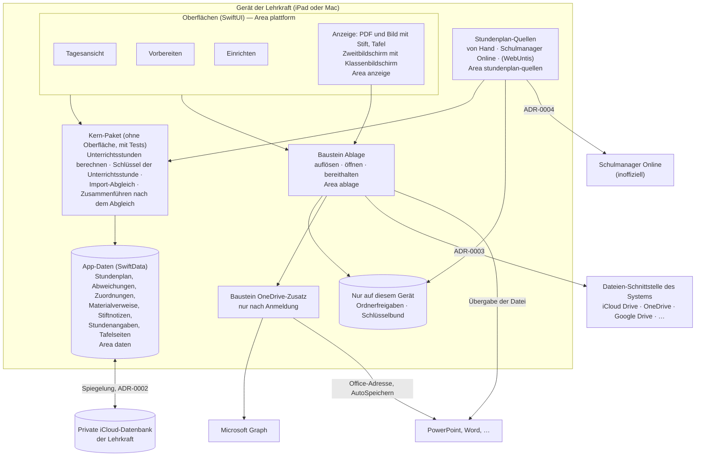

# Tagesmappe — Architektur

**Beschreibt, entscheidet nicht.** Jede Festlegung ist eine ADR (`docs/adr/NNNN-titel.md`); dieses
Dokument sagt, wie gebaut wird, innerhalb dessen, was die ADRs festgelegt haben, und verweist mit
„gemäß ADR-NNNN“ darauf. Begriffe folgen dem Glossar im PRD.

**Besitzt nicht:** was das Produkt kann (`docs/PRD.md`) und wie es aussieht (`DESIGN.md`).

---

## Überblick

Abgeleitet aus den Bereichen unten; bei Abweichung gilt der Bereich.

Drei Dinge, die das Bild festhält: Keine Oberfläche spricht ein Fremdsystem direkt an – dazwischen
liegt immer ein Baustein. Es gibt keinen Server des Produkts (NFR-2); nach außen gehen nur Apple,
der Ablage-Anbieter, Microsoft (nach Anmeldung) und Schulmanager (wenn gewählt). Ordnerfreigaben und
Zugangsdaten verlassen das Gerät nie.

## Area: plattform

- area-status: detailed

Gemäß ADR-0001: eine native SwiftUI-App in einem Xcode-Projekt mit zwei Zielen, iPadOS und macOS, aus
gemeinsamem Code. Geräteunterschiede (Stift nur am Tablet, Ziehen aus dem Finder nur am Mac) liegen in
den Oberflächen, nicht im Datenmodell.

### Bauen und Verteilen

- Gebaut wird ausschließlich auf macOS – per CI (GitHub Actions, macOS-Runner) oder auf einem Mac. Der
  Entwicklungsrechner ist Windows und kann weder bauen noch testen.
- CI läuft nur bei Tags und auf manuellen Anstoß, nicht bei jedem Push (Runner kosten je Lauf).
- Logik, die sich ohne Oberfläche prüfen lässt (Stundenplan-Auflösung, Identität, Import-Abgleich),
  liegt in einem eigenen Swift-Paket mit Tests, damit ein CI-Lauf möglichst viel belegt.
- Verteilung an Testerinnen über TestFlight; dafür ist ein Apple-Entwicklerkonto nötig (RISK-4).
- Texte der Oberfläche liegen von Anfang an in einer Übersetzungstabelle (deutsch als erste Sprache),
  damit weitere Sprachen ohne Umbau möglich sind (Q-10).

## Area: daten

- area-status: detailed

### Datenmodell

Gemäß ADR-0002 (SwiftData, gespiegelt in die private iCloud-Datenbank) und ADR-0005 (Identität der
Unterrichtsstunde). Wegen der Spiegelung sind alle Eigenschaften optional oder haben einen
Vorgabewert, alle Beziehungen sind optional, und kein Modell nutzt Eindeutigkeitsregeln.

| Modell | Trägt | Hinweis |
|---|---|---|
| Stundenplan | Name, gültig ab/bis, Stundenplan-Quelle, Zahl der Wochenvarianten (1 oder 2), Bezugswoche für A | genau einer ist aktiv |
| Stundenplan-Eintrag | Wochenvariante, Wochentag, Stunde, Klasse, Fach | gehört zu einem Stundenplan |
| unterrichtsfreier Zeitraum | von, bis, Bezeichnung | FR-7 |
| Abweichung | Datum, Schlüssel der Unterrichtsstunde, Art (Ausfall, Vertretungsstunde), bei Vertretungsstunde: Stunde, Klasse, Fach | FR-8, FR-9, FR-2.2 |
| Zuordnung | Schlüssel der Unterrichtsstunde, Position, Verweis auf das Material | FR-3, FR-3.1 |
| Materialverweis | Ordnerfreigabe, Pfad darin, ggf. OneDrive-Kennung, Anzeigename, Dateiart | gemäß ADR-0003 |
| Stiftnotiz | Verweis auf die Zuordnung, Seite (bei Bildern 1), Zeichnungsdaten, Seitengröße beim Zeichnen | gemäß ADR-0006, FR-6.1; s. Area anzeige |
| Stundenangaben | Schlüssel der Unterrichtsstunde, Thema, Hinweis | FR-11.1; höchstens ein Datensatz je Unterrichtsstunde |
| Tafelseite | Schlüssel der Unterrichtsstunde, Position, Hintergrund (leer, liniert, kariert), Zeichnungsdaten | FR-12.1, FR-12.2; die Tafelseiten einer Unterrichtsstunde bilden ihr Tafelbild; s. Area anzeige |
| Ordnerfreigabe | dauerhafter Systemverweis auf einen freigegebenen Ordner | **nur lokal je Gerät**, nicht gespiegelt (s. Area ablage) |

**Unterrichtsstunden werden nicht gespeichert, sondern berechnet:** aus Stundenplan, Wochenvariante des
Datums, unterrichtsfreien Zeiträumen und Abweichungen. Gespeichert wird nur, was die Lehrkraft dazu
tut (Zuordnungen, Abweichungen).

**Schlüssel der Unterrichtsstunde** gemäß ADR-0005: Datum + Klasse + Fach + laufende Nummer am Tag
(1 für die erste Stunde dieser Klasse in diesem Fach an diesem Tag, 2 für die zweite …). Klasse und
Fach werden vor dem Vergleich normalisiert (Groß-/Kleinschreibung, Leerzeichen, führende Nullen:
„8 b“, „08B“ → „8b“).

**Material ohne Stunde:** Passt zu einer Zuordnung keine berechnete Unterrichtsstunde mehr (Tag wurde
unterrichtsfrei, Klasse fällt an dem Tag weg), bleibt die Zuordnung erhalten und erscheint am
betreffenden Datum als „ohne Stunde“, bis die Lehrkraft sie verschiebt (FR-7, ADR-0005).

### Nebenläufigkeit

Gemäß ADR-0002 gewinnt bei gleichzeitiger Änderung desselben Datensatzes der zuletzt abgeglichene
Stand. Je Datenart:

| Datenart | Verhalten | Unterlegener Wert |
|---|---|---|
| Zuordnung hinzufügen (zwei Geräte, dieselbe Unterrichtsstunde) | beide bleiben; doppelte Verweise auf dieselbe Datei in derselben Unterrichtsstunde führt die App nach dem Abgleich zu einem zusammen | geht nicht verloren |
| Reihenfolge der Materialien | zuletzt abgeglichene Reihenfolge gilt; gleiche Positionen werden nach Anlagezeit aufgelöst | Reihenfolge des anderen Geräts verloren – hinnehmbar, sichtbar und sofort korrigierbar |
| Stundenplan-Eintrag ändern | zuletzt abgeglichener Stand gilt | verloren – selten (Stundenplan ändert sich wenige Male im Jahr) |
| Abweichung (Ausfall, Vertretungsstunde) | doppelte gleichartige Abweichungen werden zusammengeführt | geht nicht verloren |
| Stiftnotiz (zwei Geräte, dieselbe Seite derselben Zuordnung) | zuletzt abgeglichener Stand der Seite gilt | Striche des anderen Geräts auf dieser Seite verloren – selten (geschrieben wird am Tablet im Unterricht, s. Area anzeige) |

| Tafelseite (zwei Geräte, dieselbe Seite) | zuletzt abgeglichener Stand der Seite gilt | wie Stiftnotiz – selten |
| Stundenangaben (Thema, Hinweis) | doppelte Datensätze derselben Unterrichtsstunde werden zusammengeführt; je Feld gilt der zuletzt abgeglichene Stand | überschriebener Text verloren – hinnehmbar, sichtbar und sofort korrigierbar |

Zusammenführen heißt: Nach jedem Abgleich sucht die App Datensätze mit gleichem fachlichem Schlüssel
und behält den ältesten. Werden dabei zwei Zuordnungen zu einer, werden die Stiftnotizen der
aufgegebenen vorher an die behaltene gehängt.

### Betrieb

Sicherung und Wiederherstellung übernimmt iCloud im Konto der Lehrkraft (gemäß ADR-0002). Der zu
prüfende Wiederherstellungsweg ist: App auf einem zweiten Gerät mit demselben Apple-Konto
installieren – Stundenplan und Zuordnungen erscheinen ohne Zutun; nur die Ordnerfreigaben müssen dort
einmal neu erteilt werden.

## Area: ablage

- area-status: detailed

Gemäß ADR-0003.

### Zugriff auf Material

- Die Lehrkraft gibt einmal je Gerät einen oder mehrere Ordner ihrer Ablage frei (Ordnerauswahl des
  Systems). Die App hält dafür je Ordner eine Ordnerfreigabe; diese ist an das Gerät gebunden und wird
  nicht gespiegelt.
- Ein Materialverweis nennt die Ordnerfreigabe über einen gespiegelten Namen der Freigabe plus den
  Pfad darin. Auf einem zweiten Gerät wird derselbe Ordner einmal freigegeben und dem Namen zugeordnet;
  danach lösen alle Verweise auch dort auf.
- Löst ein Verweis nicht auf (Datei umbenannt, verschoben, Freigabe fehlt), zeigt die Zuordnung das an
  und bietet Neuverknüpfen an; sie verschwindet nicht.

### Öffnen

| Material | Weg |
|---|---|
| Präsentation, Dokument, Tabelle – ohne OneDrive-Anmeldung | Übergabe der Datei an die zuständige App (Öffnen am Ort, keine Kopie) |
| Office-Datei in OneDrive, Lehrkraft bei Microsoft angemeldet | Öffnen als Cloud-Dokument über die Office-Adresse, damit AutoSpeichern greift (FR-5.1) |
| PDF, Bild | eigene Anzeige (Area anzeige) |

Schlägt das Öffnen als Cloud-Dokument fehl oder dauert es zu lang, fällt die App auf die Übergabe der
Datei zurück – das Verhalten, das OneDrive Opener am Mac dafür gefunden hat (Fenster „öffnet
ungewöhnlich lange“ mit „Lokal öffnen“).

### Bereithalten

Für NFR-1 stößt die App für das Material der kommenden Unterrichtsstunden (heute und nächster
Unterrichtstag) das Herunterladen über die Dateien-Schnittstelle an, sobald Netz da ist – beim Öffnen
der App und beim Zuordnen. Die Tagesansicht zeigt je Material, ob es auf dem Gerät liegt.

### Fremdsysteme

- **Dateien-App und Ablage-Anbieter.** Grenze: ein Baustein „Ablage“, der Verweise auflöst, Dateien
  öffnet und bereithält; keine Oberfläche spricht Anbieter direkt an. Güte der Beschreibung:
  dokumentierte Systemschnittstelle, das Verhalten der einzelnen Anbieter dahinter ist aber
  unterschiedlich und nur durch Ausprobieren belegt. Bei Abweichung: Material als „nicht verfügbar“
  kennzeichnen, nie stillschweigend einen alten Stand zeigen.
- **Microsoft Graph und Office-Adressen (OneDrive).** Grenze: ein Baustein „OneDrive-Zusatz“, nur aktiv
  nach Anmeldung. Güte: Graph ist dokumentiert; das Format der Office-Adresse, mit der PowerPoint ein
  Cloud-Dokument öffnet, ist rückentwickelt (Erkenntnis aus OneDrive Opener, dort für den Mac belegt,
  für iPadOS ungeprüft – Q-18). Bei Abweichung: Rückfall auf die Übergabe der Datei.

## Area: stundenplan-quellen

- area-status: detailed

Gemäß ADR-0004. Jede Stundenplan-Quelle ist ein Baustein mit derselben Schnittstelle: Er liefert eine
Liste von Stundenplan-Einträgen und – wenn die Quelle das kann – Abweichungen für einen Zeitraum.
Bausteine: „von Hand“ (liefert nichts, der Stundenplan wird in der App gepflegt), „Schulmanager
Online“, später „WebUntis“ (FR-2.1).

### Import-Abgleich

- Ein Import ersetzt den Stundenplan nicht blind: Er wird mit dem vorhandenen verglichen. Neue und
  geänderte Einträge werden der Lehrkraft vor der Übernahme gezeigt; von Hand geänderte Einträge gehen
  nie stillschweigend verloren (AK-3).
- Abweichungen aus der Quelle (Vertretungen, Ausfall) werden als Abweichungen mit Herkunft „Quelle“
  gespeichert und beim nächsten Import ersetzt; von Hand angelegte Abweichungen bleiben unberührt.
- Zeitpunkt gemäß ADR-0004: beim ersten Öffnen der App am Tag, soweit möglich als
  Hintergrund-Aktualisierung am Morgen, und auf Knopfdruck. Die Tagesansicht zeigt, von wann der Stand
  ist.

### Fremdsysteme

- **Schulmanager Online.** Grenze: allein der Baustein „Schulmanager Online“; fällt er aus, bleiben
  Stundenplan, Zuordnungen und Tagesansicht nutzbar. Güte der Beschreibung: rückentwickelt, ohne
  Zusage des Anbieters; für Lehrerkonten ungeprüft (Q-16). Bei Abweichung (Anmeldung scheitert,
  Antwort hat unerwartete Form): kein Teilimport, letzter Stand bleibt, die Tagesansicht zeigt das
  Alter des Stands und einen Hinweis; dreimal in Folge gescheitert → Hinweis, den Stundenplan von Hand
  zu pflegen.
- Zugangsdaten liegen nur im Schlüsselbund des Geräts (NFR-4) und werden nicht gespiegelt; auf einem
  zweiten Gerät meldet sich die Lehrkraft dort erneut an.

## Area: anzeige

- area-status: detailed

Eigene Anzeige von PDFs und Bildern mit Stift (FR-6), gebaut mit den Systembausteinen für
PDF-Darstellung (PDFKit) und Stifteingabe (PencilKit), gemäß ADR-0001. Präsentiert wird über die
Bildschirmverbindung des Systems (AirPlay oder Kabel); die App baut keine eigene Übertragung, liefert
dem verbundenen Bildschirm aber einen eigenen Inhalt (FR-6.2).

### Zweitbildschirm

Grundlage ist Apples Entwicklerdoku „Presenting content on a connected display“ (gelesen 2026-11-13):

- Ohne Zutun der App spiegelt das System das Tablet-Bild auf den verbundenen Bildschirm. Für eigenen
  Inhalt stellt das System eine zweite Szene mit der Rolle `windowExternalDisplayNonInteractive`
  bereit; ihr Inhalt füllt den ganzen Bildschirm und nimmt keine Eingaben an. (Eine „Szene“ ist in
  UIKit eine eigenständige Instanz der Oberfläche mit eigenem Fenster. SwiftUI hat dafür keinen
  eigenen Baustein – die Szene wird in UIKit angelegt und zeigt eine SwiftUI-Ansicht über
  `UIHostingController`.)
- Ab iOS 27 bekommt die App diese Szene nur, wenn sie vorher ein Szenen-Zubehör anmeldet
  (`UISceneAccessory.externalNonInteractive`, angemeldet an einem View-Controller mit
  `registerSceneAccessory`). In früheren Versionen verband das System die Szene von selbst. Die
  Anmeldung gilt, solange dieser View-Controller gezeigt wird.
- Weil die Tagesansicht nie auf dem Zweitbildschirm erscheinen darf (FR-6.2), wird das Zubehör an der
  Hauptansicht der App angemeldet und gilt damit, solange die App im Vordergrund ist – nicht erst, wenn
  die Anzeige offen ist. Sonst würde das System die Tagesansicht spiegeln.
- Die Szene zeigt genau einen von vier Zuständen (FR-11.5): **Klassenbildschirm** (Ruhezustand,
  FR-11), **Material** (aktuelle Seite mit Stiftnotizen), **Tafel** (aktuelle Tafelseite, FR-12) oder
  **Dunkel** (FR-11.4) – immer ohne Bedienelemente. Blättern, Zoomen und Schreiben am Tablet werden
  dorthin übertragen.
- Der Zustand liegt an einer Stelle („Zustand des Zweitbildschirms“), die beide Szenen beobachten:
  Die Szene auf dem Tablet ändert ihn, die Szene auf dem Zweitbildschirm zeichnet ihn. Das
  Vorschaubild am Tablet (FR-11.5) ist dieselbe Ansicht noch einmal, verkleinert – kein Bildschirmfoto,
  damit es nie etwas anderes zeigt als der Zweitbildschirm.
- Dieser Zustand samt Timer (FR-11.2) und Arbeitsform (FR-11.3) ist flüchtig: Er gilt für die laufende
  Unterrichtsstunde auf diesem Gerät, wird nicht gespeichert und nicht gespiegelt. Der Timer rechnet
  aus einem Endzeitpunkt, nicht aus gezählten Sekunden, damit er nach einem kurzen Wechsel in eine
  andere App stimmt.
- Die App bleibt ohne verbundenen Bildschirm voll nutzbar; Verbinden und Trennen mitten in der Stunde
  ändern nur, ob die zweite Szene existiert.
- Die Verbindung startet die App nicht selbst (FR-11.6): Dafür gibt es keine erlaubte Schnittstelle;
  die einbaubare AirPlay-Auswahl (`AVRoutePickerView`) leitet nur Ton und Video weiter und liefert
  keine zweite Szene. Den Verbindungsstand leitet die App daraus ab, ob das System die zweite Szene
  verbunden hat – AirPlay und Kabel sind für sie dasselbe. „So verbinden“ ist eine Anleitung in der
  App, kein Sprung in das Kontrollzentrum (auch dafür gibt es keine Schnittstelle).
- Geht die App in den Hintergrund (Material öffnet in PowerPoint, FR-5), endet ihr Einfluss auf den
  Bildschirm; es gilt, was die andere App und das System tun (RISK-5, Q-22).
- Am Mac regelt das System, ob ein AirPlay-Bildschirm spiegelt oder eigener Bildschirm ist; die App
  baut dafür nichts Eigenes.

Nicht belegt und am Gerät zu prüfen: das Verhalten über AirPlay im Schulnetz (Verzögerung beim
Schreiben), und der Übergang zwischen eigener Szene und Spiegelung beim App-Wechsel.

### Darstellung

- Die Datei wird über den Baustein „Ablage“ gelesen (Ordnerfreigabe, Area ablage) und nur gelesen –
  die Anzeige schreibt nie in die Ablage (gemäß ADR-0006).
- Ein PDF wird seitenweise gezeigt; ein Bild gilt als Dokument mit einer Seite. Über jeder Seite liegt
  eine durchsichtige Zeichenfläche, die mit der Seite zoomt und verschiebt.
- Geschrieben wird am Tablet mit dem Stift. Am Mac werden Stiftnotizen angezeigt, aber nicht
  gezeichnet (Area plattform: Stift nur am Tablet). Hinweis für den Bau: Die Zeichenfläche von
  PencilKit gibt es nach heutigem Stand nur auf dem Tablet, das Datenformat der Zeichnung lässt sich
  aber auch am Mac lesen und darstellen – beim ersten Bau zu belegen.

### Klassenbildschirm

- Klasse, Fach und Stundenende kommen aus der berechneten laufenden Unterrichtsstunde (Area daten),
  Thema und Hinweis aus den Stundenangaben (FR-11.1). Er bekommt nur die Daten dieser einen
  Unterrichtsstunde gereicht – so kann er nichts anderer Klassen und keine Dateinamen zeigen (FR-11).
- Was er zeigt, wenn keine Unterrichtsstunde läuft, ist offen (Q-25 im PRD).
- Der Timer liegt als eigene Schicht über allen Zuständen außer Dunkel, damit er auch über Material
  und Tafel sichtbar bleibt; am Ende gibt er ein sichtbares und hörbares Signal (FR-11.2). Der Ton
  läuft über die Tonausgabe des Systems und damit bei AirPlay über den Bildschirm im Klassenraum.

### Tafel

- Die Tafel ist dieselbe Zeichenfläche wie in der Darstellung von Material, nur ohne Datei darunter:
  statt einer PDF-Seite liegt ein gezeichneter Hintergrund (leer, liniert, kariert) unter der
  Stiftschicht.
- Je Seite ein Datensatz „Tafelseite“ an der Unterrichtsstunde (Area daten), gespeichert und
  gespiegelt wie Stiftnotizen (ausgelagerte Zeichnungsdaten, Speichern beim Absetzen des Stifts).
  Das folgt dem Muster von ADR-0006: Die App schreibt dafür nicht in die Ablage.
- „Letztes Tafelbild“ (FR-12.3) wird berechnet, nicht gespeichert: die jüngste frühere
  Unterrichtsstunde mit gleicher Klasse und gleichem Fach, zu der Tafelseiten existieren. Fällt eine
  Unterrichtsstunde später aus dem Stundenplan, bleiben ihre Tafelseiten erhalten und darüber
  erreichbar.
- Sichern als PDF (FR-12.4): Die App erzeugt das PDF aus Hintergrund und Zeichnung und übergibt es
  dem Teilen-Dialog des Systems; die Lehrkraft wählt dort das Ziel. Die App schreibt also auch hier
  nicht selbst über eine Ordnerfreigabe in die Ablage, und es entsteht kein zweiter Stand eines
  Materials (FR-3.4 betrifft Material, nicht Tafelbilder).
- Geschrieben wird am Tablet. Am Mac lassen sich Tafelbilder ansehen und als PDF sichern, nicht
  zeichnen (wie bei Stiftnotizen).

### Stiftnotizen

Gemäß ADR-0006 liegen Stiftnotizen getrennt von der Datei in den App-Daten und werden wie diese
gespiegelt (ADR-0002); gemäß FR-6.1 gehören sie zur Zuordnung.

- Je Zuordnung und Seite ein Datensatz „Stiftnotiz“ mit den Zeichnungsdaten. Die Zeichnungsdaten
  werden als ausgelagerter Anhang gespeichert (SwiftData: `@Attribute(.externalStorage)` – der Wert
  liegt dann nicht in der Datenbankzeile, sondern als eigene Datei, und wird beim Spiegeln als Anhang
  übertragen), damit große Zeichnungen den Abgleich der übrigen Daten nicht bremsen.
- Gespeichert wird beim Absetzen des Stifts mit kurzer Verzögerung und sicher beim Schließen (AK-13).
- „In die nächste Stunde schieben“ und das Weiterreichen bei Ausfall ändern nur den Schlüssel der
  Unterrichtsstunde an der bestehenden Zuordnung – die Stiftnotizen hängen weiter daran und wandern
  mit. „Für <Klasse> übernehmen“ legt eine neue Zuordnung an, ohne Stiftnotizen (FR-6.1, AK-22).
- Wird eine Zuordnung gelöscht, werden ihre Stiftnotizen mitgelöscht.
- Die Stiftnotiz merkt sich die Seitengröße, auf der gezeichnet wurde. Weicht die Seite beim Öffnen
  davon ab oder gibt es die Seite nicht mehr (Datei in der Ablage ersetzt oder umgebaut), zeigt die
  Anzeige die Notiz weiter an und weist darauf hin, dass sie zu einer früheren Fassung gehört – sie
  wird nie stillschweigend verworfen (Kosten gemäß ADR-0006).
- Löst der Materialverweis nicht auf, bleiben die Stiftnotizen an der Zuordnung erhalten und sind nach
  dem Neuverknüpfen wieder da.

---

## Open Questions

- ~~Q-14~~: Wovon hängt die Identität einer Unterrichtsstunde ab, damit Zuordnungen eine Änderung des Stundenplans überstehen? → answered 2026-11-13: Datum + Klasse + Fach + laufende Nummer, Material folgt der Klasse (ADR-0005, accepted)
- ~~Q-15~~: Wie oft und wodurch ausgelöst wird der Schulmanager abgefragt, und wie spät dürfen Vertretungen dort ankommen? → answered 2026-11-13: einmal je Morgen und auf Knopfdruck; Vertretungen am selben Morgen (ADR-0004, accepted)
- ~~Q-17~~: Wo liegen Stiftnotizen auf PDFs und Bildern – in der Datei in der Ablage (dann sieht sie jede andere App und jedes Gerät, das Original ist aber verändert) oder getrennt in den App-Daten (Original bleibt unberührt, Notizen sieht nur diese App)? Bis zur Klärung wird nichts angenommen; der Bereich `anzeige` bleibt `draft`. → answered 2026-11-13: getrennt in den App-Daten (ADR-0006, accepted); je Zuordnung (FR-6.1, Q-20 im PRD)
- Q-18: Öffnet PowerPoint auf iPadOS ein OneDrive-Dokument über die Office-Adresse mit AutoSpeichern, so wie am Mac? (Prüfung auf einem echten iPad nötig; siehe RISK-2.)

## Changes

- 2026-11-13: plattform, daten, ablage, stundenplan-quellen, anzeige new — Bereichsliste vor der ersten ADR
- 2026-11-13: plattform, daten, ablage, stundenplan-quellen changed — ausgearbeitet nach Freigabe der ADR-Ebene; anzeige bleibt draft (Q-17)
- 2026-11-13: anzeige changed — ausgearbeitet nach ADR-0006 (Stiftnotizen getrennt in den App-Daten) und FR-6.1 (je Zuordnung); daten changed — Modell Stiftnotiz, Nebenläufigkeit und Zusammenführen ergänzt
- 2026-11-13: Überblick new — Bausteinbild, abgeleitet aus den Bereichen
- 2026-11-13: anzeige changed — Zweitbildschirm über eigene Szene statt reiner Spiegelung (FR-6.2); vorher: „Präsentiert wird über die Bildschirmspiegelung des Systems (AirPlay); die App baut keine eigene Übertragung.“
- 2026-11-13: anzeige changed — vier Zustände des Zweitbildschirms, Klassenbildschirm und Tafel (FR-11, FR-12); daten changed — Modelle Stundenangaben und Tafelseite, Nebenläufigkeit ergänzt
- 2026-11-13: anzeige changed — Timer als Schicht über allen Zuständen (FR-11.2); Verbindung wird erkannt, nicht gestartet (FR-11.6)
